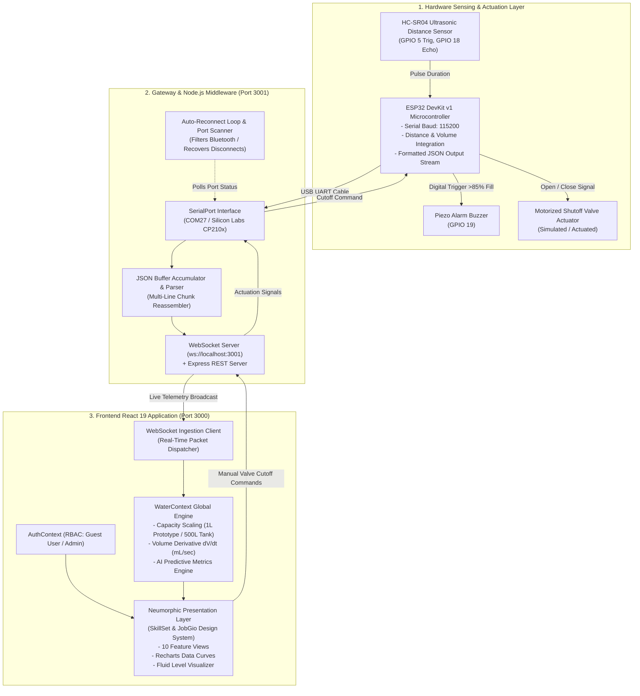

# DROP X - Project Technical & Functional Documentation
> **Tagline:** *"Every Drop Counts. Every Drop Matters."*  
> **Platform Version:** `v2.4 Ultrasonic Edition`  
> **Repository:** [GitHub - Sanjaycode21/DropX](https://github.com/Sanjaycode21/DropX.git)

---

## 📑 Table of Contents
1. [Executive Summary & Problem Statement](#1-executive-summary--problem-statement)
2. [Complete System Architecture](#2-complete-system-architecture)
3. [Hardware & IoT Telemetry Pipeline](#3-hardware--iot-telemetry-pipeline)
   - [3.1 Microcontroller & Ultrasonic Sensor Node](#31-microcontroller--ultrasonic-sensor-node)
   - [3.2 Mathematical Formulas for Level & Volume](#32-mathematical-formulas-for-level--volume)
   - [3.3 Gateway Reassembly & Auto-Reconnect Loop](#33-gateway-reassembly--auto-reconnect-loop)
4. [Software & Frontend Design Architecture](#4-software--frontend-design-architecture)
   - [4.1 Neumorphic Light UI System](#41-neumorphic-light-ui-system)
   - [4.2 State Management & WebSocket Ingestion](#42-state-management--websocket-ingestion)
   - [4.3 Error Boundary & Resilience](#43-error-boundary--resilience)
5. [In-Depth Feature Catalog (All 10 Views)](#5-in-depth-feature-catalog-all-10-views)
   - [Module 1: Real-Time Executive Dashboard](#module-1-real-time-executive-dashboard)
   - [Module 2: Water Consumption Analytics](#module-2-water-consumption-analytics)
   - [Module 3: AI Leak Detection & Ultrasonic Anomaly Guard](#module-3-ai-leak-detection--ultrasonic-anomaly-guard)
   - [Module 4: AI Water Demand Prediction & Weather Synergy](#module-4-ai-water-demand-prediction--weather-synergy)
   - [Module 5: Tiered Municipal Cost Estimation (₹ INR)](#module-5-tiered-municipal-cost-estimation--inr)
   - [Module 6: Smart Recommendations & Dynamic Automation](#module-6-smart-recommendations--dynamic-automation)
   - [Module 7: Peer Benchmarking & Conservation Leaderboard](#module-7-peer-benchmarking--conservation-leaderboard)
   - [Module 8: Audit Reports & CSV Export Engine](#module-8-audit-reports--csv-export-engine)
   - [Module 9: Multi-Tier Notification & Alarm Drawer](#module-9-multi-tier-notification--alarm-drawer)
   - [Module 10: Hardware Configuration & ESP32 C++ Firmware](#module-10-hardware-configuration--esp32-c-firmware)
6. [Interactive Hackathon Scenario Simulator](#6-interactive-hackathon-scenario-simulator)
7. [Authentication & Role-Based Access Control (RBAC)](#7-authentication--role-based-access-control-rbac)
8. [Setup, Deployment & Manual Execution Guide](#8-setup-deployment--manual-execution-guide)

---

## 1. Executive Summary & Problem Statement

### The Problem
Water scarcity and unmonitored municipal distribution lead to billions of liters wasted daily through:
- **Unnoticed Micro-Leaks:** Running toilet flappers and minor fissures often account for 20% to 35% of total household water bills before discovery.
- **Catastrophic Ruptures:** Pipe bursts and tank overflows cause expensive structural damage within minutes if manual intervention fails.
- **Lack of Real-Time Feedback:** Homeowners receive opaque monthly water utility bills after the waste has already occurred.
- **Complex Tariff Slabs:** Most consumers are unaware of municipal volumetric slab penalizations (e.g., Tier 1 baseline vs Tier 3 surcharge rates).

### The Solution: DROP X
**DROP X** is an end-to-end smart hydro-management platform bridging real physical IoT sensor nodes with an AI-driven, neumorphic light web dashboard. By pairing ultrasonic distance sensors with high-frequency WebSocket streaming, DROP X provides real-time level monitoring, instant flow velocity derivative tracking ($dV/dt$), predictive leak detection, and automated shutoff commands.

---

## 2. Complete System Architecture



---

## 3. Hardware & IoT Telemetry Pipeline

### 3.1 Microcontroller & Ultrasonic Sensor Node
- **Microcontroller:** ESP32 DevKit v1 (32-bit dual-core Xtensa LX6 @ 240MHz).
- **Ultrasonic Range Sensor:** HC-SR04 (Sonar range: 2 cm to 400 cm with ~3 mm accuracy).
- **Piezo Sounder:** 5V active buzzer triggered when the liquid level exceeds 85% full capacity.
- **Physical Pin Mapping:**
  | Pin Name | Microcontroller GPIO | Direction / Function |
  | :--- | :--- | :--- |
  | `TRIG` | GPIO 5 | Output: 10µs ultrasonic sonic pulse |
  | `ECHO` | GPIO 18 | Input: Measures echo bounce duration |
  | `BUZZER` | GPIO 19 | Output: Emergency audible high-level alarm |
  | `VCC` | VIN (5V) | Power input |
  | `GND` | GND | Ground plane |

### 3.2 Mathematical Formulas for Level & Volume
The sensor emits a 40kHz ultrasound burst and measures the time-of-flight ($\Delta t$ in microseconds):

1. **Air Gap Distance ($D_{\text{cm}}$):**
   $$\text{Distance} = \frac{\Delta t \times 0.0343}{2}$$

2. **Water Column Height ($H_{\text{cm}}$):**
   $$H = \max(0, H_{\text{tank}} - \text{Distance})$$

3. **Percentage Level Fill ($L_{\%}$):**
   $$L_{\%} = \min\left(100, \max\left(0, \frac{H}{H_{\text{tank}}} \times 100\right)\right)$$

4. **Calibrated Liquid Volume ($V$):**
   - **Prototype Mode (1.0 Liter Container):**
     $$V_{\text{liters}} = \frac{L_{\%}}{100} \times 1.0 \text{ L} \quad (V_{\text{mL}} = V_{\text{liters}} \times 1000)$$
   - **Main Storage Mode (500.0 Liter Overhead Reservoir):**
     $$V_{\text{liters}} = \frac{L_{\%}}{100} \times 500.0 \text{ L}$$

5. **Real-Time Flow Velocity ($Q$ in $\text{mL/sec}$):**
   $$Q = \frac{\Delta V}{\Delta t} \quad (\text{Display standardized to mL/sec for live prototype fidelity})$$

### 3.3 Gateway Reassembly & Auto-Reconnect Loop
- **Multi-Line Reassembly:** ESP32 prints JSON formatted across multiple line breaks. `server/index.js` uses a string accumulator buffer that searches for matching `{` and `}` delimiters and parses only complete JSON objects.
- **Bluetooth Virtual Port Filtering:** Windows auto-enumerates Bluetooth devices into `COM5`, `COM7`, etc. The gateway filters out all `BTHENUM` entries and explicitly binds to real USB UART bridge controllers (`Silicon Labs CP210x` on `COM27`).
- **Zero-Crash Hot-Plug Reconnection:** If the USB cable is unplugged, the serial port emits a `close` event. A 4-second polling timer repeatedly scans and locks back onto the hardware node the moment it is plugged back in.

---

## 4. Software & Frontend Design Architecture

### 4.1 Neumorphic Light UI System
- **Aesthetic Inspiration:** High-end SaaS interfaces (*SkillSet* and *JobGio* reference design systems).
- **Background Palette:** Soft off-white canvas (`#eef1f5`) paired with pure white neumorphic cards (`#ffffff`).
- **Visual Elevation:**
  - Standard cards utilize dual-layer soft ambient drop shadows: `0 10px 25px -5px rgba(15, 23, 42, 0.04)`.
  - Lead KPI card utilizes deep slate (`#18181b`) with high contrast text for visual prominence.
- **Interaction Model:** Tactile pill filter buttons (`.pill-button-active`, `.pill-button-inactive`) with smooth cubic-bezier transitions.

### 4.2 State Management & WebSocket Ingestion
- `WaterContext.jsx` acts as the single source of truth for all hydro telemetry.
- Listens to incoming WebSocket payloads from `ws://localhost:3001`.
- Automatically scales metrics based on the active capacity toggle (1L Prototype vs 500L Main Tank).
- Feeds live 20-point rolling telemetry into Recharts area diagrams and Diurnal bar charts without UI stutter.

### 4.3 Error Boundary & Resilience
- Implements `ErrorBoundary.jsx` around the core `<main>` view in `App.jsx`.
- Prevents component render crashes (e.g. unhandled sensor formatting or network blips) from displaying a blank screen, showing an inline recovery card with a one-click reload button instead.

---

## 5. In-Depth Feature Catalog (All 10 Views)

### Module 1: Real-Time Executive Dashboard
- **Top 4 Neumorphic KPI Stat Cards:**
  1. *Total Water Level Fill (%):* Dark highlighted lead card with dynamic liquid progress bar.
  2. *Current Volume (Liters & mL):* Precision calibrated volume readout.
  3. *Real-Time Flow Velocity (mL/sec):* Active consumption speed with live pulsating indicator.
  4. *Projected Monthly Bill (₹ INR):* Current municipal expenditure forecast based on usage.
- **Interactive Storage Tank Visualizer:**
  - Vertical fluid graphic with realistic wavy liquid animation.
  - Live distance readout (`cm`) directly from the ultrasonic transceiver.
  - One-click capacity toggle: **1L Prototype** (desktop testing) vs **500L Main Tank** (home installation).
- **Diurnal Telemetry Bar Chart:**
  - Rounded dark bars showing hourly intake variations.
- **AI Hydro-Predictive Intelligence Engine:**
  - **Depletion ETA:** Calculated hours/minutes remaining under current flow drain.
  - **Overflow ETA:** Time-to-full indicator during refill cycles.
  - **Micro-Seepage Risk Index (%):** Statistical variance algorithm detecting unseen pipe leaks.
  - **Smart Refill Window:** Recommends optimal municipal refill hours (e.g. 02:00 AM - 05:00 AM).
  - **Sensor Signal Fidelity Score (%):** Hardware health score tracking packet loss and jitter.
- **Recent Hardware Telemetry Event Log:**
  - Timestamped table showing the latest serial packets received from `ESP32-WTR-8842`.

---

### Module 2: Water Consumption Analytics
- **Timeframe Multi-Filters:** Toggle between *24-Hour Diurnal*, *Past 7 Days*, and *Month View*.
- **Per Capita Usage Indicator:** Compares daily volume against the standard 135 L/person/day municipal benchmark.
- **Fixture Breakdown Distribution:** Pie chart breaking down usage across Showers, Washing Machine, Kitchen Sink, Garden Irrigation, and Toilets.
- **Peak Consumption Audit Log:** Records high-velocity draw events with duration and fixture attribution.

---

### Module 3: AI Leak Detection & Ultrasonic Anomaly Guard
- **Continuous Height Slope Analysis:** Differentiates normal consumption from silent leaks by analyzing continuous downward height decay during quiet nighttime hours.
- **Real-Time Flow Stream Area Chart:** Gradient-filled wave chart plotting real-time velocity.
- **Zonal Sensor Array Grid:** Displays individual statuses for Zone 1 (Main Tank), Zone 2 (Master Ensuite), Zone 3 (Kitchen), and Zone 4 (Outdoor Irrigation).
- **Hydrostatic Integrity Diagnostic Test:** One-click simulation running an automated 2-second integrity audit.
- **Emergency Main Cutoff Switch:** Instantly actuates valve shutoff to halt further water loss.

---

### Module 4: AI Water Demand Prediction & Weather Synergy
- **Weather-Correlated Demand Forecasting:** Machine learning neural model predicting water consumption 7 days and 30 days into the future.
- **Atmospheric Correlation:** Incorporates ambient temperature (°C) and precipitation probability (%).
- **Monsoon Rain Pause Logic:** Automatically lowers intake expectations during rainy days to prevent unnecessary automated lawn watering.

---

### Module 5: Tiered Municipal Cost Estimation (₹ INR)
- **Indian Municipal Tariff Structure:**
  - **Tier 1 (Lifeline Slab):** 0 to 15,000 Liters @ ₹28.00 / kL.
  - **Tier 2 (Standard Domestic):** 15,001 to 30,000 Liters @ ₹45.00 / kL.
  - **Tier 3 (High Surcharge):** > 30,000 Liters @ ₹75.00 / kL.
- **Interactive "What-If" Savings Slider:** Allows homeowners to simulate 0% to 50% consumption reduction, calculating immediate monthly and annual rupee savings.

---

### Module 6: Smart Recommendations & Dynamic Automation
- **Interactive Automation Rules:**
  - Rule 1: Ultrasonic Overflow Auto-Alarm (distance < 5.0 cm triggers buzzer).
  - Rule 2: Night Owl Micro-Leak Sentry (unattended flow between 02:00 AM and 04:30 AM).
  - Rule 3: Weather Predictive Rain Pause (suspends sprinkler zone on >60% rain forecast).
  - Rule 4: Daily Budget Exceeded Governor (notifies when daily target is crossed).
- **Eco-Habit Checklist:** Interactive conservation actions with canvas confetti celebration animations.

---

### Module 7: Peer Benchmarking & Conservation Leaderboard
- **Community Comparison:** Compares household consumption against the 4-person district average and top 10% eco-efficient residences.
- **Neighborhood Leaderboard:** Ranks villas and homes across the water district with conservation badges (*Master Conserver*, *Zero Waste*, *Water Hero*).

---

### Module 8: Audit Reports & CSV Export Engine
- **Historical Audit Table:** Complete daily breakdown with dates, total volume, peak velocity, detected leaks, and billing amount.
- **Data Export:** Instant one-click client-side CSV generation (`DROP_X_Water_Audit.csv`).
- **Printer-Friendly Mode:** Native formatting support for physical auditing reports.

---

### Module 9: Multi-Tier Notification & Alarm Drawer
- **Notification Classification:** Filters alerts into *Critical*, *Warning*, and *Info* categories.
- **Interactive Controls:** Mark all as read, delete individual notifications, or trigger test alert simulations.

---

### Module 10: Hardware Configuration & ESP32 C++ Firmware
- **Firmware Code Exporter:** Ready-to-copy C++ Arduino sketch for ESP32 with `ArduinoJson`, ultrasonic distance calculation, and active buzzer thresholds.
- **MQTT Broker Settings:** Configurable broker URI and publish/subscribe topics.
- **Physical Tank Calibration:** Editable tank height (`cm`) and daily allocation budget limits (`L`).

---

## 6. Interactive Hackathon Scenario Simulator

Located directly beneath the main navbar, the **Scenario Simulator Bar** allows evaluators to simulate real-world municipal events without moving physical hardware:
- 🛡️ **Normal Flow:** Baseline steady telemetry (`2.8 L/min`, 55 PSI).
- 🚿 **Morning Shower:** High draw event (`11.5 L/min`).
- 💧 **Silent Micro-Leak:** Simulates running toilet flapper (`1.8 L/min`), triggering warning alerts.
- ⚠️ **Pipe Burst Alert:** Catastrophic failure (`45.0 L/min`) with critical buzzer alert and emergency shutoff prompt.
- 🌱 **Lawn Sprinkler:** Outdoor irrigation demand (`22.0 L/min`).
- 🌿 **Eco Saver Mode:** Aerated low-flow fixtures (`1.2 L/min`).

---

## 7. Authentication & Role-Based Access Control (RBAC)

DROP X implements a dual-role authentication system with pre-configured demo evaluator access:

### 1. Citizen / Resident Profile (`user@dropx.com`)
- **Default Display Name:** `Guest User`
- **Role:** Resident / Homeowner (`Villa #42, Cyan Valley Heights`)
- **Permissions:** Full access to household telemetry, leak sentry, predictions, billing calculator, and personal recommendations.

### 2. Administrator Profile (`admin@dropx.com`)
- **Default Display Name:** `Administrator`
- **Role:** Grid Supervisory Control & District Water Authority
- **Permissions:** Access to district-wide controls, sensor node arrays, municipal rate parameters, and infrastructure settings.

---

## 8. Setup, Deployment & Manual Execution Guide

### Prerequisites
- **Node.js** v18.0 or newer.
- **Hardware (Optional):** ESP32 DevKit connected via USB UART cable.

### Step 1: Install Dependencies
```bash
npm install
```

### Step 2: Start the Backend Telemetry Gateway (Terminal 1)
```bash
npm run server
```
*(Runs on `http://localhost:3001` and opens `ws://localhost:3001`)*

### Step 3: Start the Frontend Application (Terminal 2)
```bash
npm run dev
```
*(Runs on `http://localhost:3000`)*

### Step 4: Open in Browser
Visit **`http://localhost:3000`** in Chrome, Edge, or Safari. The frontend will automatically link to the WebSocket gateway and begin streaming real-time sensor telemetry.
