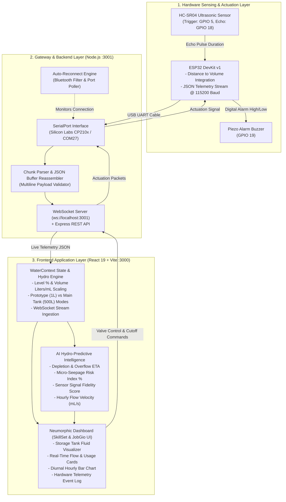

# DROP X - Smart Water Monitoring, Leak Detection & Conservation Platform
> *"Every Drop Counts. Every Drop Matters."*

**DROP X** is an end-to-end intelligent IoT water management and hydro-analytics platform. It connects physical microcontroller nodes (ESP32 + HC-SR04 ultrasonic distance sensor) to a responsive neumorphic React dashboard in real time, delivering high-precision water level indication, volume calculation, flow velocity tracking, AI-driven leak detection, and municipal tiered billing estimation.

---

## 🏛️ System Architecture



---

## 🚀 How to Run Manually (Frontend & Backend)

Running DROP X manually requires two lightweight processes:
1. **The Backend Telemetry Gateway** (Node.js on port `3001`): Reads ESP32 serial data from the USB COM port and broadcasts live telemetry over WebSockets.
2. **The Frontend Dashboard** (Vite on port `3000`): Renders the interactive UI and connects to the telemetry WebSocket.

### Prerequisites
- [Node.js](https://nodejs.org/) installed (v18 or higher recommended).
- ESP32 connected to your PC via USB cable (e.g. `COM27` or detected USB-UART COM port).

---

### Step 1: Install Dependencies
Open a terminal in the project root directory and run:
```bash
npm install
```

---

### Step 2: Start the Backend Gateway (Terminal 1)
Open your first terminal window in the project folder and run:
```bash
npm run server
```
*(Or alternatively: `node server/index.js`)*

**What this does:**
- Starts an Express & WebSocket server at `http://localhost:3001` (`ws://localhost:3001`).
- Scans available serial ports, filters out virtual Bluetooth ports, and attaches to your ESP32 device at `115200` baud.
- Automatically retries and reconnects if the USB cable is unplugged and re-plugged.

---

### Step 3: Start the Frontend App (Terminal 2)
Open a second terminal window in the project folder and run:
```bash
npm run dev
```

**What this does:**
- Boots the Vite development server with Hot Module Replacement (HMR).
- Opens the application at **`http://localhost:3000`**.

---

### Step 4: Open in Your Browser
Visit:
```
http://localhost:3000
```
The dashboard will immediately establish a WebSocket link with `ws://localhost:3001` and display live ultrasonic level, volume, flow velocity, and AI analytics directly from your sensor.

---

## 🔑 Demo Login Credentials

You can click the **One-Click Demo Evaluator** buttons on the login screen or enter:

### 1. Citizen / Resident Account
- **Email:** `user@dropx.com`
- **Password:** `user123`
- **User:** `Guest User` (*Villa #42, Cyan Valley Heights*)
- **Role:** Resident / Homeowner Smart Node

### 2. Administrator Account
- **Email:** `admin@dropx.com`
- **Password:** `admin123`
- **User:** `Administrator`
- **Role:** Municipal Grid Supervisory Control & District Water Authority

---

## 💡 Key Platform Capabilities

1. **Hardware Telemetry Integration**:
   - HC-SR04 ultrasonic distance measurement converted to real-time water depth $H = H_{tank} - \text{Distance}$.
   - Dual capacity scaling: **1L Prototype Container** (for live desktop testing) and **500L Overhead Tank** (for real-world deployment).
2. **Real-Time Flow Velocity**:
   - Live flow display calibrated in **`mL/sec`** for prototype demonstration.
3. **AI Hydro-Predictive Intelligence Engine**:
   - **Depletion / Overflow ETA**: Calculates time-to-empty and time-to-full based on instant derivative consumption rates.
   - **Micro-Seepage Risk Index (%)**: Continuous slope variance detection flagging slow leaks (e.g., faulty toilet flapper or pinhole pipe leak).
   - **Smart Refill Schedule**: Suggests automated off-peak municipal refill timing.
   - **Sensor Signal Fidelity Score (%)**: Tracks packet jitter, echo variance, and signal noise.
4. **Slab-Based Municipal Cost Calculator**:
   - Real-world Indian water tariff tiers (Tier 1 Lifeline, Tier 2 Domestic, Tier 3 Surcharge).
5. **Emergency Cutoff & Anomaly Sentry**:
   - One-click motorized valve actuation (`OPEN`, `CLOSED`, `AUTO_LOCK`).
   - Hardware telemetry log table displaying timestamped serial packets.

---

## 🔌 Hardware Wiring & Pinout Guide

| ESP32 DevKit Pin | Component Pin | Function / Description |
| :--- | :--- | :--- |
| **GPIO 5** | HC-SR04 `TRIG` | 10µs ultrasonic trigger pulse output |
| **GPIO 18** | HC-SR04 `ECHO` | Echo return pulse duration input |
| **GPIO 19** | Active Buzzer `+` | High level alarm actuation (>85% fill) |
| **VIN / 5V** | Sensor `VCC` | 5V DC power supply |
| **GND** | Sensor / Buzzer `GND` | Common ground reference |

---

## 🛠️ Tech Stack
- **Frontend:** React 19, Tailwind CSS, Recharts, Lucide Icons
- **Backend / Gateway:** Node.js, Express, `ws` (WebSockets), `serialport`
- **Firmware:** ESP32 C++ / ArduinoJson (available in Settings tab)
- **Tooling:** Vite, ESLint / Oxlint
